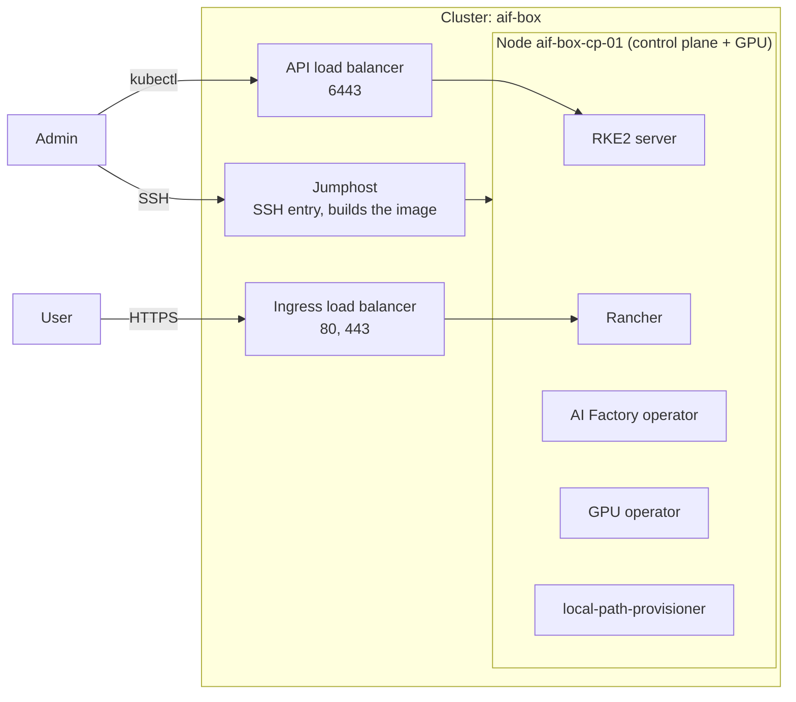

# 01: Inference in a box

One node that runs everything: Rancher, the AI Factory operator, the NVIDIA GPU
operator and local storage. Use it to try AI Factory or to serve models on a
single GPU.

Status: not yet verified end to end.

## What you get

- One RKE2 cluster with a single node. The node is a control-plane node and has the GPU.
- Rancher with the AI Factory operator.
- GPU operator, so pods can request `nvidia.com/gpu`.
- Local volumes through local-path-provisioner (the default StorageClass).
- A jumphost, an API load balancer and an ingress load balancer. They stay even with one node, so the cluster can grow later.

No high availability. If the node is down, the cluster is down.

## Diagram

## Components

| Component | Why |
|---|---|
| `rancher` | Web UI and cluster management. Also installs cert-manager. |
| `aif-operator` | Deploys and manages AI Factory workloads. Needs `rancher`. |
| `gpu-operator` | Installs the NVIDIA driver and device plugin on the node. |
| `local-path-provisioner` | Default StorageClass. A volume is stored on the node that runs its pod. |

## Sizing

- One GPU plan for the whole cluster. The provider guide names the example plan.
- Rancher, the operators and your models share that one node. Pick a plan with CPU and RAM left over after the model.
- Volumes use the root disk of the node.
- Price the plan before you deploy: `tools/multicluster/cluster.sh cost box`.

## Limits

- Single node: no HA, and a node replacement loses the local volumes.
- The node is both control plane and GPU worker, so cluster services and your workloads share it.
- Plans and stock are per region. GPU stock varies by region.
- The cluster is one location with no zones.
- `components` is an image input. Changing it rebuilds the image and replaces the node.

## Grow and variants

- Grow to HA: set `control_plane_count` from 1 to 3 and run `deploy` again. The existing node is kept; see [scaling](../../docs/scaling.md#control-plane). Shrinking back to 1 is not supported.
- All control-plane nodes get the same plan. A 3-node cluster with a GPU plan on each node is costly; add a `gpu_pools` entry and use a smaller control-plane plan instead. Changing the plan of the single existing control-plane node replaces it, and the cluster is lost. This is not a supported path. Choose the plan before the first deploy. To change it later, redeploy the cluster or grow it to 3 control-plane nodes first.
- `suse-storage` with `control_plane_count = 1` fails plan with the default `suse_storage_nodes`. For shared storage use [shape 02](../02-ha-storage/README.md).
- Add `ingress_domain` for your own hostnames instead of sslip.io.

## Provider guides

- [Vultr](vultr/README.md)
