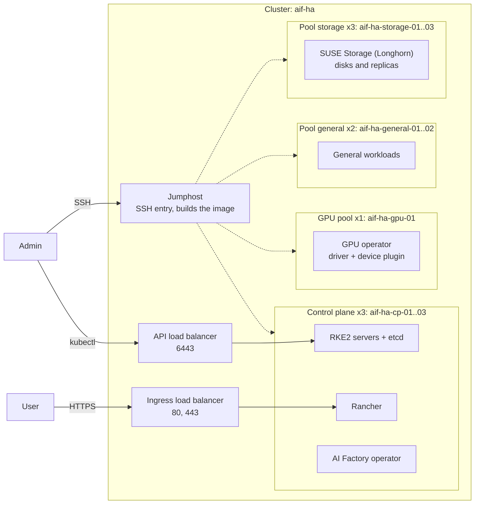

# 02: HA cluster with storage

A highly available cluster with replicated storage. Three control-plane nodes, a GPU pool, a general worker pool and a 3-node `storage` pool that stores the SUSE Storage (Longhorn) disks.

Status: not yet verified end to end.

## What you get

- RKE2 with 3 control-plane nodes (etcd quorum, one node can fail).
- Rancher with the AI Factory operator.
- GPU operator and one GPU node.
- Two general worker nodes.
- Three `storage` nodes. Longhorn keeps replicated volumes on them, and the default StorageClass is Longhorn.
- A jumphost, an API load balancer and an ingress load balancer.

## Diagram

## Components

| Component | Why |
|---|---|
| `rancher` | Web UI and cluster management. Also installs cert-manager. |
| `aif-operator` | Deploys and manages AI Factory workloads. Needs `rancher`. |
| `gpu-operator` | Installs the NVIDIA driver and device plugin on GPU nodes. |
| `suse-storage` | Replicated volumes (Longhorn) and the default StorageClass. Needs Application Collection credentials. |

Do not add `local-path-provisioner`: both components set the default StorageClass and plan fails.

`suse_storage_nodes = ["storage"]` puts the Longhorn disks on the `storage` pool only. Plan fails if fewer than three nodes get disks.

## Sizing

- Control plane: 3 nodes, about 4 vCPU and 16 GiB each.
- GPU pool: size by the models you serve. One node is enough to start.
- General pool: for services that do not need a GPU.
- Storage pool: 3 nodes, so volumes can keep 3 replicas. Longhorn uses the root disk of each node, so the disk size of the plan sets the capacity. The provider guide names the example plan and its disk.
- Price it first: `tools/multicluster/cluster.sh cost ha`.

## Limits

- Pools have no taints or labels. The `storage` pool also runs general workloads, and the GPU pool also runs pods that do not use a GPU.
- Longhorn uses the node root disk. There is no separate data volume.
- Replacing or removing a storage node needs care: drain it and check that no volume has its only healthy replica there ([scaling](../../docs/scaling.md#storage)).
- `components` is an image input. Changing it rebuilds the image and replaces every node.
- The cluster is one location with no zones.

## Grow and variants

- More GPU nodes: raise `count` in `gpu_pools`. New nodes join; nothing else changes ([scaling](../../docs/scaling.md#worker-and-gpu-pools)).
- More storage: raise the `storage` count or add a pool and list it in `suse_storage_nodes`. The selection is in each node's Ignition, so it does not rebuild the image ([scaling](../../docs/scaling.md#storage)).
- More control-plane nodes: 3 to 5, odd numbers only. Shrinking is not supported.
- Less cost: use `suse_storage_nodes = ["control_plane"]` and drop the `storage` pool. Control-plane nodes then hold the disks.
- Add `ingress_domain` for your own hostnames instead of sslip.io.
- Single node without HA: [shape 01](../01-inference-in-a-box/README.md).

## Provider guides

- [Vultr](vultr/README.md)
