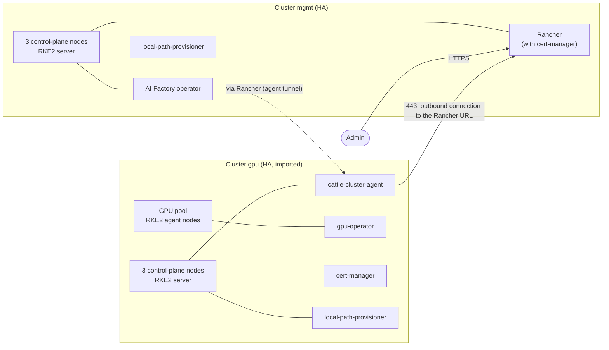

# 03: Management and GPU downstream

Status: not yet verified end to end.

## What you get

Two clusters, each with its own network and load balancers.

- `mgmt`: three control-plane nodes, no workers. It runs Rancher and the AI
  Factory operator.
- `gpu`: three control-plane nodes and one GPU pool. It runs the GPU stack.
  `register` imports it into the Rancher on `mgmt`, so the AI Factory operator
  can target it.

Use it when AI workloads and the tools that manage them should live apart,
and when you want more GPU clusters later.

## Diagram

The agent in `gpu` opens the connection to `mgmt`. `mgmt` never connects to the
nodes of `gpu`. For that reason, the `mgmt` ingress must accept the `gpu`
egress addresses (`ingress_cidrs`, default open).

## Components

### mgmt

| Component | Why |
|---|---|
| `rancher` | Manages and imports clusters. It brings cert-manager as a release-manifest dependency, so cert-manager is not listed. |
| `aif-operator` | Installs and manages AI Factory workloads. It requires `rancher` in the same list. |
| `local-path-provisioner` | Default StorageClass for Rancher and operator volumes. A volume is stored on the node of its pod. |

### gpu

| Component | Why |
|---|---|
| `cert-manager` | Lets workloads request certificates. |
| `gpu-operator` | Makes the GPUs usable: driver, device plugin, toolkit. |
| `local-path-provisioner` | Default StorageClass. A volume is stored on the node of its pod and is lost with that node. |

`gpu` has no `rancher` entry, so its `rancher_*` outputs are null. `register`
only needs them from `mgmt`.

## Sizing

| Cluster | Nodes | Notes |
|---|---|---|
| `mgmt` | 3 control-plane | Default control-plane size. Add `control_plane_instance_type` for a bigger plan. |
| `gpu` | 3 control-plane + GPU pool | Start with 1 GPU node; raise `count` when stock allows. |

Each cluster also has a jumphost, an API load balancer, an ingress load
balancer and a NAT gateway. The estimate for your values:
`tools/multicluster/cluster.sh cost <name>`.

## Limits

- `components` is an image input. Changing it rebuilds the image and replaces
  every node of that cluster.
- Pools have no taints or labels. Pods that need no GPU can also run on the GPU
  nodes, and the control-plane nodes accept workloads as usual.
- `local-path-provisioner` volumes are tied to one node. For replicated storage
  see [shape 04](../04-mgmt-gpu-storage/README.md).
- Each cluster is one location. There is no multi-zone setup.
- The cluster names `aif-mgmt` and `aif-gpu` in the examples are only
  examples. Names must be unique inside your account.

## Grow and variants

- More GPU nodes: raise `count` in `gpu_pools`, then run `deploy` again.
  Existing nodes stay. See [scaling](../../docs/scaling.md).
- More GPU clusters: create another cluster with a new name and run
  `register mgmt <name>`. Earlier registrations stay.
- Replicated storage and general worker nodes:
  [shape 04](../04-mgmt-gpu-storage/README.md).
- Own DNS names: set `ingress_domain` in each cluster.

## Provider guides

- [Vultr](vultr/README.md)

Shared prerequisites for all shapes: [../README.md#shared-prerequisites](../README.md#shared-prerequisites).
