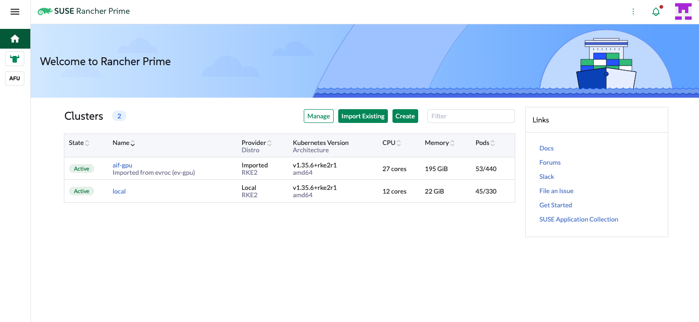
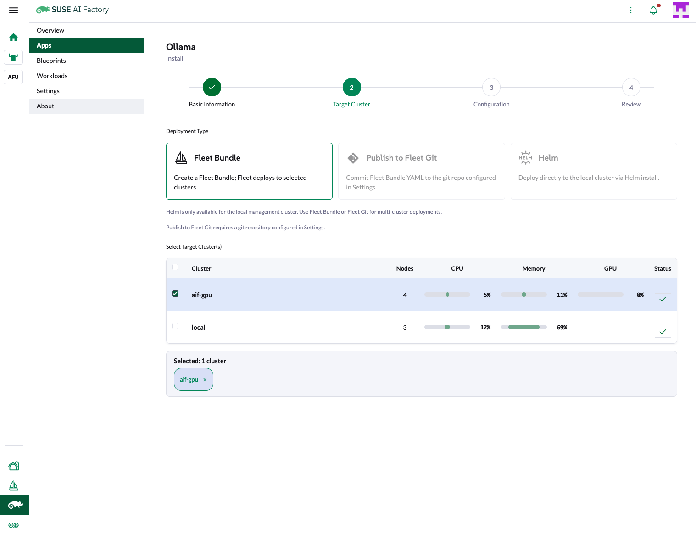

# 03: Management and GPU downstream on evroc

Shape overview: [../README.md](../README.md). Status: verified end to end on 2026-10-30 (se-sto, aif 2.3.0, RKE2 v1.35.6): 3 control planes per cluster over zones a, b and c, the L40S allocatable on `aif-gpu-gpu-01`, `register --bootstrap` imported `aif-gpu` (Active within about 80 seconds, through the platform NAT with the default `ingress_cidrs`), and AI Factory lists `aif-gpu` as a target cluster with its GPU.
Two clusters from `examples/evroc`, run with `tools/multicluster/cluster.sh`.

## Prerequisites

- The shared prerequisites: [../../README.md#shared-prerequisites](../../README.md#shared-prerequisites).
  This includes `clusters/common-all.tfvars`.
- `evroc login`. It writes `~/.evroc/config.yaml`. The provider reads the
  credentials, the region and the project from it, and `deploy.sh` stops when
  the file is missing. No API key goes in the tfvars.
  `clusters/common-evroc.tfvars` is optional: it may set `region` (for example
  `"se-sto"`) and `project`. When they are null, the login values are used.
- Application Collection credentials (`appco_username`, `appco_password`): both
  clusters need them through `local-path-provisioner`.
- GPU quota. Only zone `a` admits GPU VMs, and the plan checks it: keep `"a"`
  first in `zones` (the default). The profile `gn-l40s.s` is one L40S GPU
  (48 GB, 15 vCPU, 190 GB memory), passed through to the VM. GPU quota is per
  GPU model and counted in GPUs. A default project has one L40S. The plan
  cannot see it: a denied create shows up at apply and leaves the boot disk of
  the node in state (lower `count`, or destroy). After the plan,
  `terraform -chdir=clusters/gpu output provider_details` shows
  `gpu_quota_request`. GPU VMs use no vCPU or memory quota.
- Quota for vCPU, memory and public IPs is per organization. The defaults are
  20 vCPU, 160 GB memory and 3 public IPs, plus the GPU quota. Ask evroc to
  raise them. The footprint of this shape:

  | Cluster | vCPU | Memory | Public IPs | GPUs |
  |---|---|---|---|---|
  | `mgmt` (jumphost 4 + 3 control planes x 4) | 16 | 48 GB | 2 | 0 |
  | `gpu` (jumphost 4 + 3 control planes x 4) | 16 | 48 GB | 2 | 1 L40S |
  | Total | 32 | 96 GB | 4 | 1 L40S |

  Memory peaks in pass 1: three `a1a.m` build hosts (48 GB) against 40 GB in
  pass 2 (jumphost 16 GB + 3 x `c1a.m` 8 GB). The total is above the default
  vCPU and public IP quota: ask for a raise before you deploy.

  On `mgmt`, Rancher and the AI Factory operator used about 69% of the memory
  of 3 x `c1a.m` (8 GB) right after the deploy. For more headroom set
  `control_plane_instance_type = "a1a.m"` (16 GB); this adds 24 GB to the
  footprint.

  The plan fails when the peak footprint of the cluster it plans (the larger of
  pass 1 and pass 2) exceeds the organization limit. It does not count other
  clusters. The second cluster can pass plan and be denied at apply. Quota is
  released asynchronously after a destroy: re-run `deploy.sh` when a create is
  denied right after one. `provider_details.quota_request` shows the demand and
  the limit. See [Quota](../../../docs/providers/evroc.md#quota).
- Go, for the cost estimate.
- Network: each cluster has its own VPC with the default `vpc_cidr`. The
  clusters talk only through public addresses, so the same range in both is
  fine. See [Networking](../../../docs/providers/evroc.md#networking).

## Steps

Run from the repo root.

1. Create and edit the management cluster.

   ```bash
   tools/multicluster/cluster.sh new --empty evroc mgmt
   cp catalog/03-mgmt-gpu/evroc/mgmt.tfvars.example clusters/mgmt/terraform.tfvars
   $EDITOR clusters/mgmt/terraform.tfvars
   tools/multicluster/cluster.sh cost mgmt
   tools/multicluster/cluster.sh deploy mgmt
   ```

   `cp` onto the existing file keeps its mode 600.

2. Create and edit the GPU cluster.

   ```bash
   tools/multicluster/cluster.sh new --empty evroc gpu
   cp catalog/03-mgmt-gpu/evroc/gpu.tfvars.example clusters/gpu/terraform.tfvars
   $EDITOR clusters/gpu/terraform.tfvars
   tools/multicluster/cluster.sh cost gpu
   tools/multicluster/cluster.sh deploy gpu
   ```

   Each deploy runs up to three passes and takes tens of minutes: pass 1
   builds the image (one build host per zone), pass 2 makes a snapshot per zone
   and creates the nodes, pass 3 reclaims the build disks. See
   [Passes](../../../examples/evroc/README.md#passes). Follow the build with
   `clusters/<name>/build-logs.sh`. There is no serial console.

3. Import `gpu` into the management Rancher.

   ```bash
   tools/multicluster/cluster.sh register --bootstrap mgmt gpu
   ```

   `--bootstrap` is needed once, because a new Rancher has no API token yet. It
   logs in with the bootstrap password, creates an admin token, and replaces the
   admin password with a random one. The token is kept in
   `clusters/.register/mgmt/`. That directory is a secret.

   Read the new admin password from the repo root:

   ```bash
   TF_DATA_DIR="$PWD/clusters/.register/mgmt/.terraform" \
     terraform -chdir=tools/multicluster/register output -raw admin_password
   ```

   The nodes of `gpu` have no public IP and leave through a platform NAT whose
   addresses are not exposed. `egress_ips` is empty, so `register` prints
   "reports no egress_ips; make sure the management ingress_cidrs admit it" and
   continues. Keep the `ingress_cidrs` of `mgmt` at the default `0.0.0.0/0`:
   the source addresses of `gpu` are not known.

## Verify

```bash
tools/multicluster/cluster.sh list
terraform -chdir=clusters/mgmt output -raw rancher_url
```

- Open the Rancher URL and log in as `admin`. The cluster `aif-gpu` is
  listed and `Active`. `register` imports it under its `cluster_name`.

  

- In Rancher open SUSE AI Factory, Apps, pick an app and Install. In Target
  Cluster, choose Fleet Bundle: `aif-gpu` is listed with a GPU column.

  

  Both screenshots are from the test run on 2026-10-30.
- Check that `mgmt` has one control plane per zone:
  `terraform -chdir=clusters/mgmt output nodes`.
- On `gpu`, check the GPU. Fetch the kubeconfig to a file, with mode 600:

  ```bash
  mkdir -p ~/.kube
  clusters/gpu/kubeconfig.sh --wait -o ~/.kube/aif-gpu.yaml
  KUBECONFIG=~/.kube/aif-gpu.yaml kubectl get nodes
  KUBECONFIG=~/.kube/aif-gpu.yaml kubectl get pods -n gpu-operator
  ```

  The GPU node reports `nvidia.com/gpu` in its capacity once the operator is
  ready. The module uses an experimental precompiled SLES 16.1 driver build by
  default: see [docs/workarounds.md](../../../docs/workarounds.md).

## Cost

Run `tools/multicluster/cluster.sh cost mgmt` and `... cost gpu` before you
deploy. The estimate is not a quote. It prices VMs, disks and public IPs from a
checked-in rate card (EUR, excluding VAT). The load balancer, the snapshots
and the traffic are not included. Build hosts and build disks are shown as
build only. Each cluster has these billed objects:

- the jumphost, the control-plane nodes and the pool nodes (`gpu`)
- their disks
- two public IPs (the API VIP and the jumphost)
- one load balancer
- one image snapshot per zone

The GPU profile is the main cost.
See [Cost estimate](../../../docs/providers/evroc.md#cost-estimate).

## Destroy

Destroy the downstream cluster first, then the management cluster.

```bash
tools/multicluster/cluster.sh destroy gpu
tools/multicluster/cluster.sh destroy mgmt
```

- Deleting `gpu` does not remove its entry in Rancher: the imported cluster
  stays, and Rancher reports it as unreachable. Delete it in the Rancher UI,
  then remove `gpu` from `clusters/.register/mgmt/downstream.list` so that a
  later `register` does not use it again.
- When `mgmt` is destroyed, `clusters/.register/mgmt/` is stale. Delete the
  directory before you deploy a new `mgmt`, and use `--bootstrap` again.
- After a successful destroy, `deploy.sh` prints the leftovers check. It does
  not run it. Run it yourself, with the `evroc` CLI logged in:

  ```bash
  tools/leftovers/evroc.sh aif-gpu
  tools/leftovers/evroc.sh aif-mgmt
  ```

  It deletes nothing. Expect `0 live`. Exit code 0 means nothing is left, 1
  means something is left, 3 means the check was inconclusive. See
  [Leftover check](../../../docs/providers/evroc.md#leftover-check).
- Quota is released asynchronously after a destroy. Wait a little before you
  deploy again.
- To reuse the names `gpu` or `mgmt`, remove the old directories first:
  `cluster.sh new` refuses an existing one (`rm -rf clusters/gpu clusters/mgmt`).

## Troubleshooting

- Plan fails with "vCPU / Memory / Public IP quota: this cluster needs N ...":
  the footprint of that cluster exceeds the organization limit. Ask evroc for a
  raise, or use a smaller profile.
- Plan fails with "Requested flavors not offered": a profile is not offered.
  The error lists the available ones.
- `cannot deploy a GPU VM in zone "b"`: pin the GPU pool to `a`, or list `a`
  first in `zones`.
- `not enough quota ... nvidia.com/AD102GL_L40S` at apply: the GPU quota is
  used up. Lower `count`, or ask evroc.
- Apply is denied for vCPU, memory or public IPs on the second cluster: the
  plan does not count other clusters. Raise the quota, or destroy a cluster.
- `register` prints "reports no egress_ips": expected on evroc. Keep the
  `ingress_cidrs` of `mgmt` at `0.0.0.0/0`.
- A node never joins, or a pass fails: see the table in
  [examples/evroc/README.md#troubleshooting](../../../examples/evroc/README.md#troubleshooting).
- Platform notes (GPUs, quota, network, API VIP):
  [docs/providers/evroc.md](../../../docs/providers/evroc.md).
- Register and token handling:
  [tools/multicluster/README.md](../../../tools/multicluster/README.md).
