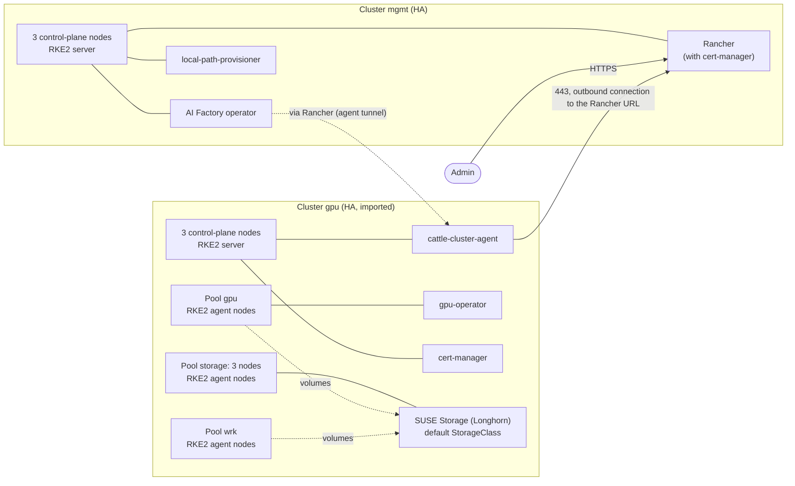

# 04: Management and GPU downstream with storage

Status: covered on vultr (2026-10-29) by the shape 05 test run, not run on its own; see the provider guide.

## What you get

Two clusters, each with its own network and load balancers.

- `mgmt`: three control-plane nodes, no workers. It runs Rancher and the AI
  Factory operator.
- `gpu`: three control-plane nodes and three worker pools:
  - `gpu`: the GPU nodes.
  - `storage`: three nodes that hold the SUSE Storage (Longhorn) disks.
  - `wrk`: general worker nodes for other workloads.

  `register` imports `gpu` into the Rancher on `mgmt`, so the AI Factory
  operator can target it.

Use it when AI workloads need volumes that survive the loss of a node. It is
[shape 03](../03-mgmt-gpu/README.md) plus replicated storage and general
workers.

## Diagram

The agent in `gpu` opens the connection to `mgmt`. `mgmt` never connects to the
nodes of `gpu`. For that reason, the `mgmt` ingress must accept the `gpu`
egress addresses (`ingress_cidrs`, default open).

## Components

### mgmt

| Component | Why |
|---|---|
| `rancher` | Manages and imports clusters. It brings cert-manager as a release-manifest dependency, so cert-manager is not listed. |
| `aif-operator` | Installs and manages AI Factory workloads. It requires `rancher` in the same list. |
| `local-path-provisioner` | Default StorageClass for Rancher and operator volumes. A volume is stored on the node of its pod. |

### gpu

| Component | Why |
|---|---|
| `cert-manager` | Lets workloads request certificates. |
| `gpu-operator` | Makes the GPUs usable: driver, device plugin, toolkit. |
| `suse-storage` | Replicated volumes (Longhorn) and the default StorageClass. `suse_storage_nodes = ["storage"]` puts the disks on the `storage` pool only. |

`local-path-provisioner` is not listed on `gpu`. Listing both storage
components fails plan, because both set the default StorageClass.

`gpu` has no `rancher` entry, so its `rancher_*` outputs are null. `register`
only needs them from `mgmt`.

## Sizing

| Cluster | Nodes | Notes |
|---|---|---|
| `mgmt` | 3 control-plane | Default control-plane size. |
| `gpu` | 3 control-plane | Default control-plane size. |
| `gpu` pool `gpu` | 1 GPU node | A passthrough GPU plan. Raise `count` when stock allows. |
| `gpu` pool `storage` | 3 nodes | Pick a plan with a large root disk: Longhorn uses it, so the disk size sets the capacity. |
| `gpu` pool `wrk` | 2 nodes | Size for your workloads. |

The provider guide lists the example plans.

Longhorn needs at least three nodes with disks. Plan fails with fewer. The
estimate for your values: `tools/multicluster/cluster.sh cost <name>`.

## Limits

- `components` is an image input. Changing it rebuilds the image and replaces
  every node of that cluster.
- Pools have no taints or labels. The storage pool also runs general
  workloads, and the GPU pool also runs pods that need no GPU. Heavy workloads
  on `storage` compete with Longhorn for CPU, memory and disk.
- Longhorn uses the node root disk. There is no separate data volume.
- `suse_storage_nodes` reaches new nodes only. Changing it later needs a label
  on the existing nodes ([scaling](../../docs/scaling.md#storage)).
- Shrinking a pool or removing it destroys nodes without a drain. Drain them
  and check Longhorn replicas first.
- Each cluster is one location. There is no multi-zone setup.

## Grow and variants

- More storage: raise `count` of the `storage` pool. New nodes get disks
  automatically.
- More GPU nodes: raise `count` in `gpu_pools`, then run `deploy` again.
- More GPU clusters: create another cluster with a new name and run
  `register mgmt <name>`.
- No general workers: remove the `wrk` pool.
- Without replicated storage: [shape 03](../03-mgmt-gpu/README.md).
- Own DNS names: set `ingress_domain` in each cluster.

## Provider guides

- [Vultr](vultr/README.md)

Shared prerequisites for all shapes: [../README.md#shared-prerequisites](../README.md#shared-prerequisites).
