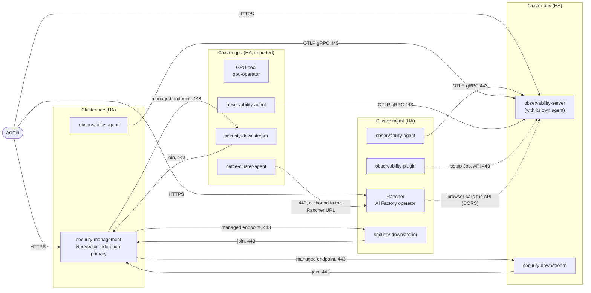

# 05: Platform

Four clusters with central monitoring and security.

Status: not yet verified end to end.

## What you get

Four clusters. Each has three control-plane nodes, its own network and its own
load balancers. Every cluster is monitored and secured.

- `mgmt`: no workers. Rancher, the AI Factory operator and the Rancher
  extension for SUSE Observability.
- `obs`: the SUSE Observability server. It receives data from all clusters.
- `sec`: the SUSE Security (NeuVector) federation primary. It shows all
  clusters in one place.
- `gpu`: the GPU workloads. One GPU pool. It is imported into the Rancher on
  `mgmt`, so the AI Factory operator can target it.

Use it when you want one place for monitoring, one place for security, and GPU
clusters that you can add later.

This shape requires `ingress_domain` on every cluster. Every cross-cluster host
name comes from your domain, so all of them are known before the first deploy.
You create one wildcard DNS record per cluster while you deploy, as soon as the
ingress IP of that cluster is known. See [Why `ingress_domain` is required](#why-ingress_domain-is-required).

## Diagram

Dotted lines are setup traffic and browser traffic. The agents on `mgmt`, `sec`
and `gpu` open every connection to `obs`. Federation uses both directions: a
downstream cluster joins the primary, and the primary then connects to the
managed endpoint of each member.

## Components

Every cluster lists the components below. Shared by all: three control-plane
nodes and the Traefik ingress.

### mgmt

| Component | Why |
|---|---|
| `rancher` | Manages and imports clusters. It brings cert-manager, so cert-manager is not listed. |
| `aif-operator` | Installs and manages AI Factory workloads. It requires `rancher` in the same list. |
| `local-path-provisioner` | Default StorageClass for Rancher and operator volumes. |
| `observability-plugin` | Adds the SUSE Observability views to the Rancher UI. It points at the remote server on `obs`. Needs `rancher`. |
| `observability-agent` | Sends metrics, traces and topology of `mgmt` to `obs`. |
| `security-downstream` | Joins the NeuVector federation on `sec`. |

### obs

| Component | Why |
|---|---|
| `observability-server` | The SUSE Observability server. It adds its own agent, so `obs` monitors itself. Needs a storage component and a license key. |
| `local-path-provisioner` | The storage component for the server. Variant: `suse-storage`, see [Grow and variants](#grow-and-variants). |
| `security-downstream` | Joins the NeuVector federation on `sec`. |

### sec

| Component | Why |
|---|---|
| `security-management` | NeuVector federation primary and the NeuVector Manager UI. |
| `local-path-provisioner` | Default StorageClass. NeuVector persistence is off, so it holds little data. |
| `observability-agent` | Sends metrics, traces and topology of `sec` to `obs`. |

### gpu

| Component | Why |
|---|---|
| `cert-manager` | Lets workloads request certificates. |
| `gpu-operator` | Makes the GPUs usable: driver, device plugin, toolkit. |
| `local-path-provisioner` | Default StorageClass. A volume is stored on the node of its pod and is lost with that node. |
| `security-downstream` | Joins the NeuVector federation on `sec`. |
| `observability-agent` | Sends metrics, traces and topology of `gpu` to `obs`. |

`obs`, `sec` and `gpu` have no `rancher`, so their `rancher_*` outputs are null.
Only `mgmt` has them.

## Cross-cluster flows

All flows use port 443 through the ingress of the target cluster. Host names are
the ones in the example files; replace `aif.example.com` with your domain.

| From | To | Host:port | Purpose |
|---|---|---|---|
| Agent and collector on `mgmt`, `sec`, `gpu` | `obs` | `otlp-obs.o11y.aif.example.com:443` | OTLP gRPC: metrics and traces. The `obs` cluster sends to its own collector inside the cluster. |
| Agent setup Job on `mgmt`, `sec`, `gpu` | `obs` | `obs.o11y.aif.example.com:443` | Waits for the API, creates the cluster token, registers the cluster, sends topology and agent data (`/receiver/stsAgent`). Checks the server with `observability_ca_pem`. |
| Plugin setup Job on `mgmt` | `obs` | `obs.o11y.aif.example.com:443` | Configures the Rancher extension with the bootstrap token. |
| Browser (Rancher extension) | `obs` | `obs.o11y.aif.example.com:443` | The extension calls the API from the browser. `obs` must allow the Rancher URL as a CORS origin (`observability_allowed_origins`), and the browser must trust the `obs` CA. |
| Controller on `mgmt`, `obs`, `gpu` | `sec` | `fed-neuvector.sec.aif.example.com:443` | NeuVector federation join with the shared join token. |
| Controller on `sec` | `mgmt`, `obs`, `gpu` | `fed-neuvector.<subdomain>.aif.example.com:443` | The primary connects to the managed endpoint of each member. |
| `cattle-cluster-agent` on `gpu` (and `sec`, `obs` if imported) | `mgmt` | `rancher.mgmt.aif.example.com:443` | Imported-cluster connection. `mgmt` never connects to the nodes. |
| NeuVector Manager on `sec` | `mgmt` | `rancher.mgmt.aif.example.com:443` | Rancher SSO. Needs `sec` imported under its `cluster_name`. |
| Browser | each UI | `rancher.mgmt...`, `obs.o11y...`, `neuvector.sec...` | The three web UIs. |

Notes:

- `otlp-http-obs.o11y...` is also published. Remote agents use OTLP gRPC; the
  HTTP endpoint is for your own senders.
- Federation trust comes from the join token. The federation endpoints use the
  NeuVector controller certificate and no client verifies it
  ([ADR 010](../../docs/decisions/010-security-observability.md)).
- Each ingress admits `ingress_cidrs`, default open. If you restrict it, admit
  the `egress_ips` outputs of the other clusters and also your admin and user
  CIDRs: browsers reach Rancher, NeuVector and the `obs` UI, and the Rancher
  extension calls `obs` from the browser (see [Limits](#limits)).

## Why `ingress_domain` is required

The clusters need each other's host names before they exist:

- `obs` must allow the Rancher URL of `mgmt` as a CORS origin
  (`observability_allowed_origins`).
- `mgmt`, `sec` and `gpu` need the server URL of `obs` and the federation
  endpoint of `sec`.
- With the default sslip.io names, a host name contains the ingress IP. The
  Rancher URL of `mgmt` exists only after `mgmt` is deployed. But `mgmt` needs
  the server URL of `obs`, which needs the Rancher URL of `mgmt`. That is a
  cycle.

With `ingress_domain` the names come from your domain, so all of them are known
before the first deploy. Each cluster needs one record `*.<domain>` that
points at its ingress IP. The IP is known only after the first apply of that
cluster, so the record is created during the deploy. The provider guide says
exactly when.

The domains used here: `mgmt.aif.example.com`, `o11y.aif.example.com`,
`sec.aif.example.com`, `gpu.aif.example.com`. The module derives the host
names from `ingress_domain`:

| Cluster | Host names |
|---|---|
| `mgmt` | `rancher.mgmt.aif.example.com`, `fed-neuvector.mgmt.aif.example.com` |
| `obs` | `obs.o11y.aif.example.com`, `otlp-obs.o11y.aif.example.com`, `otlp-http-obs.o11y.aif.example.com`, `fed-neuvector.o11y.aif.example.com` |
| `sec` | `neuvector.sec.aif.example.com`, `fed-neuvector.sec.aif.example.com` |
| `gpu` | `fed-neuvector.gpu.aif.example.com` |

The server prefix is always `obs.`, so the `obs` cluster uses the subdomain
`o11y`. With `obs.aif.example.com` the server would be `obs.obs.aif.example.com`.
Any subdomain works if you use it everywhere.

`mgmt`, `obs` and `sec` need their names before the other clusters deploy (see
the cycle above). On `gpu` the domain is a consistency choice: the primary on
`sec` connects to `fed-neuvector.gpu...`, and a fixed name keeps the DNS
records alike.

## Values that are shared or unknown at the start

- Known from the start, set in each cluster's `terraform.tfvars`:
  `observability_server_url`, `security_primary_endpoint`,
  `security_rancher_url`, `observability_allowed_origins`.
- The same on every cluster, set once in `clusters/common-all.tfvars`:
  `security_join_token` (a lowercase UUID) and `observability_bootstrap_token`.
  Every provider declares both variables, so this file may hold them. If you
  leave them null, each cluster generates its own value and the clusters do not
  agree.
- Unknown until `obs` is deployed: the Observability CA
  (`observability_ca_pem`, the `ca_pem` field of the `observability` output).
  It is written to `clusters/<name>/addons.auto.tfvars.json` for `mgmt`, `sec`
  and `gpu`. It is an image input, so `obs` is deployed first.
- Per cluster and secret: `observability_license_key`, in
  `clusters/obs/terraform.tfvars`.

Deploy order: `obs`, then `sec`, `mgmt` and `gpu`, then `register`. After `obs`
the other three do not depend on each other, so you may deploy them in
parallel. `sec` runs an agent, so it also needs the CA from `obs`. With own DNS
names the federation order is free: a member that is deployed before the primary
joins within about 15 minutes after the primary is up.

### Register decision

`register` is optional for the components: they work with clusters that are not
imported ([ADR 010](../../docs/decisions/010-security-observability.md)).

| Cluster | Register? | Why |
|---|---|---|
| `gpu` | Yes | Required: the AI Factory operator targets clusters imported in the Rancher on `mgmt`. |
| `sec` | Recommended | NeuVector Rancher SSO matches the cluster by its `cluster_name`. Without the import, remove `security_rancher_url` from `sec`. |
| `obs` | Optional | It only gives Rancher an inventory and access to `obs`. The plugin on `mgmt` reads the server through its URL, not through the import. |

The guide registers all three. The Observability and NeuVector extension views
that depend on imported clusters have not been tested on this shape.

## Sizing

| Cluster | Nodes | Plan | Notes |
|---|---|---|---|
| `mgmt` | 3 control-plane | default | Rancher, operator, plugin and agent. |
| `obs` | 3 control-plane | larger than default | Profile `20-nonha`: up to 20 monitored nodes; this shape has 13 (4 x 3 control-plane + 1 GPU). |
| `sec` | 3 control-plane | default | NeuVector controllers and the agent. |
| `gpu` | 3 control-plane + 1 GPU node | default + GPU plan | Raise the pool `count` when stock allows. |

The Observability profile name is the number of monitored nodes. The server
needs far more CPU and memory than the other components, so `obs` uses a bigger
control-plane plan. Exact needs per profile are in the SUSE Observability
requirements; they are not in this repository, so check them for your profile
before you rely on the plan chosen here. `20-nonha` is not highly available: a
node failure on `obs` stops the server until the pod runs again, and with
`local-path-provisioner` its data stays on the failed node.
An HA profile (`150-ha`) is sized for 150 nodes. Switching between HA and non-HA
later is not supported.

Each cluster also has a jumphost, an API load balancer, an ingress load balancer
and a NAT gateway. Estimate: `tools/multicluster/cluster.sh cost <name>`.

## Limits

- `components` is an image input. Changing it rebuilds the image and replaces
  every node of that cluster.
- Pools have no taints or labels. Pods that need no GPU can also run on the GPU
  nodes.
- Longhorn (`suse-storage`), if you use it, stores data on the root disk of its
  nodes.
- `local-path-provisioner` volumes belong to one node. The three control-plane
  nodes are HA for Kubernetes, not for the data on `obs`.
- The setup Jobs use the image `registry.opensuse.org/home/eminguez/containers/leap16/sts-tools`.
  It comes from a personal OBS project, not from a SUSE-supported source
  ([ADR 010](../../docs/decisions/010-security-observability.md)).
- Browsers do not trust the per-cluster CA until you import it. The UIs of `obs`
  and `sec` and the Rancher extension need it
  ([docs/security.md](../../docs/security.md#trusting-the-cluster-ca-in-the-browser)).
  Rancher uses its own certificate.
- Restricting `ingress_cidrs` has a start-up problem: the `egress_ips` of a
  cluster are known only after its first deploy. Keep the default for the first
  deploy and restrict it afterwards: every cluster admits the egress IPs of all
  the others plus your admin and user CIDRs, and `mgmt` admits `gpu` (and `sec`,
  `obs` if imported). A change of `ingress_cidrs` updates the firewall rules of
  the ingress load balancer in place; it does not rebuild the image or replace
  nodes.
- The CA and the NeuVector backend certificate are not renewed. The ingress
  certificate is renewed by an apply within 30 days of expiry, which rebuilds the
  image of that cluster.
- Each cluster is one location. There is no multi-zone setup.

## Grow and variants

- `suse-storage` on `obs` instead of `local-path-provisioner`: replicated
  volumes on the three control-plane nodes (`suse_storage_nodes` default). Replace
  the component in `components`; the two cannot be listed together. Longhorn
  uses the root disk, so choose a plan with enough disk.
- An HA Observability profile: `observability_sizing_profile = "150-ha"` with a
  bigger plan (see the provider guide). Not tested here.
- More GPU clusters: create another cluster with a new name, the same components
  as `gpu` and its own `ingress_domain`, then run `register mgmt <name>`.
  Earlier registrations stay.
- Fewer clusters: put `security-management` on `mgmt` and
  `observability-server` on `mgmt` instead of separate clusters. That is the
  layout in `tools/multicluster/README.md`.

## Provider guides

- [Vultr](vultr/README.md)

Shared prerequisites for all shapes: [../README.md#shared-prerequisites](../README.md#shared-prerequisites).
