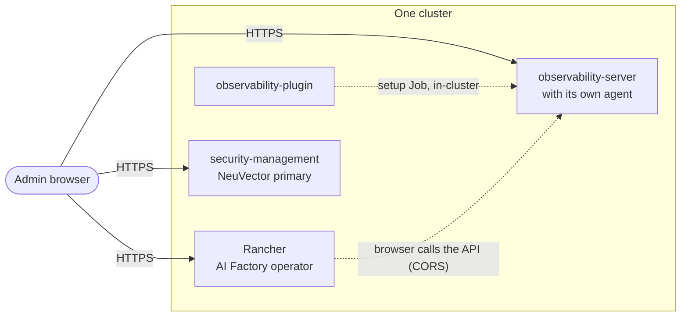
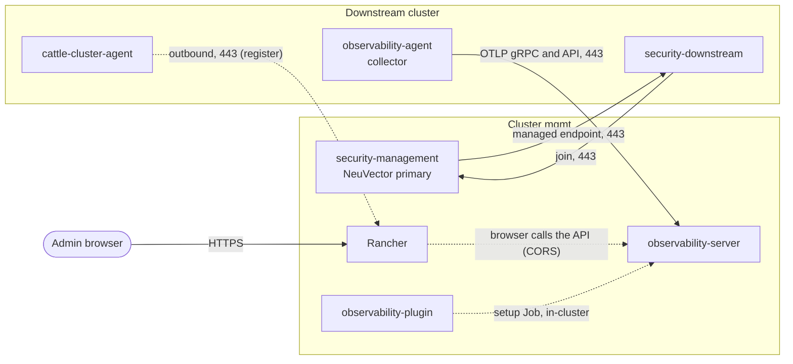
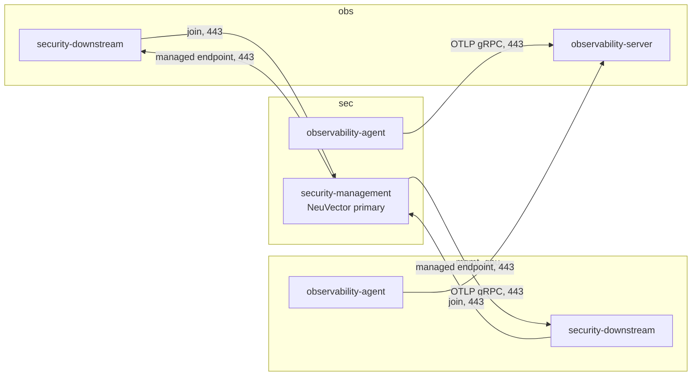
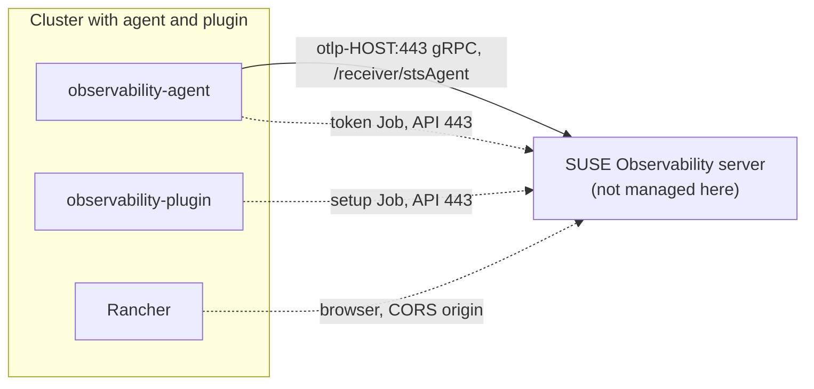

# SUSE Observability and SUSE Security

User guide for the `observability-*` and `security-*` components. They add
SUSE Observability (server, agent, OpenTelemetry collector, Rancher extension)
and SUSE Security (NeuVector, with federation across clusters) to a cluster.
The reasons for the design are in
[ADR 010](decisions/010-security-observability.md).

Status: the end-to-end checks are not complete ([e2e checklist](e2e-checklist.md#suse-security-and-suse-observability)). Where this guide reports a real run, it says so.

Contents:
[Overview](#overview) ·
[Topologies](#topologies) ·
[Variables](#variables) ·
[Hostnames and DNS](#hostnames-and-dns) ·
[TLS and the CA](#tls-and-the-ca) ·
[Cross-cluster wiring](#cross-cluster-wiring) ·
[Sizing and licensing](#sizing-and-licensing) ·
[Verify](#verify) ·
[Troubleshooting](#troubleshooting) ·
[Upgrades and versions](#upgrades-and-versions) ·
[Limits](#limits)

## Overview

You enable each part with a value in `components`. Every part is a manifest in
the image (`kubernetes/manifests/`: `observability-server-priority.yaml`,
`observability-agent-priority.yaml`, `observability-plugin-priority.yaml`,
`security-priority.yaml` and `security-ui-extension-priority.yaml`), so no
extra step runs after the deploy.

| Component | What it installs |
|---|---|
| `observability-server` | The SUSE Observability server (namespace `suse-observability`) with ingresses for the UI/API and for OTLP (gRPC and HTTP). The SUSE AI Observability extension (namespace `so-extensions`) that installs the `open-telemetry` and `suse-ai` StackPacks and the `kubernetes-v2` StackPack instance for the server cluster. It also adds `observability-agent`, so the server cluster monitors itself. |
| `observability-agent` | The SUSE Observability agent (namespace `suse-observability-agent`), the OpenTelemetry collector (namespace `open-telemetry`) and the Job `generate-cluster-token`. The Job creates this cluster's service token. With a remote server it also installs the `kubernetes-v2` StackPack instance, so the cluster registers itself. |
| `observability-plugin` | The Rancher UI extension for SUSE Observability (namespace `cattle-ui-plugin-system`) and the Job `generate-sts-config` (namespace `suse-observability-extension`). The Job writes the Secret `configuration` with the server URL and a token with the `stackstate-guest` role. |
| `security-management` | NeuVector (namespace `cattle-neuvector-system`) as the federation primary, with the Manager UI on its own hostname. With `rancher` in the same cluster it also installs the NeuVector Rancher UI extension. |
| `security-downstream` | NeuVector as a federation member. It joins the primary. It has no Manager ingress. |

What they need:

- Traefik: `ingress_controller = "traefik"` (the default; the example roots do
  not expose this variable).
- The server needs a storage component (`local-path-provisioner` or
  `suse-storage`) and a license key (`observability_license_key`).
- The server and the agent need Application Collection credentials
  (`appco_username`, `appco_password`). The server and agent charts come from
  `charts.rancher.com/server-charts/prime`. Only the SUSE AI extension and the
  OpenTelemetry collector chart come from Application Collection
  (`appco_registry`), and the credentials are for those two.
- Hostnames: `ingress_domain`, or an address that sslip.io can use. See
  [Hostnames and DNS](#hostnames-and-dns).
- The NeuVector chart version follows the Rancher version in the AI Factory
  release manifest, also on a cluster without `rancher`.

How they relate to Rancher and the AI Factory operator:

- `observability-plugin` and the NeuVector Rancher UI extension need `rancher` on
  the same cluster. The other components do not need Rancher.
- `aif-operator` does not use these components, and they do not use it. The
  operator only needs `rancher`.
- Optional extras that are not in the image (OpenTelemetry Operator,
  auto-instrumentation, a demo app) are in
  [tools/observability](../tools/observability/README.md).
- Importing a cluster into Rancher (`cluster.sh register`) is optional for
  these components. It is needed only for Rancher SSO in NeuVector and for the
  extension views of imported clusters. See [Cross-cluster wiring](#cross-cluster-wiring).

Dependencies, from the validations in `modules/common/variables-common.tf` and
the guards in `modules/elemental-config/addons.tf`:

| Component | Needs | Cannot be combined with |
|---|---|---|
| `observability-server` | Traefik; `local-path-provisioner` or `suse-storage`; `observability_license_key`; `appco_username` and `appco_password` | `observability_server_url` set |
| `observability-agent` | Traefik; `appco_username` and `appco_password`; without `observability-server`: `observability_server_url`, `observability_ca_pem`, `observability_bootstrap_token` | |
| `observability-plugin` | Traefik; `rancher`; without `observability-server`: `observability_server_url`, `observability_ca_pem`, `observability_bootstrap_token` | |
| `security-management` | Traefik | `security-downstream` |
| `security-downstream` | Traefik; `security_join_token`; `security_primary_endpoint` | `security-management` |

`components` also has the general rules: no duplicates, and not
`local-path-provisioner` together with `suse-storage`.

## Topologies

The components do not care which provider a cluster runs on. All cross-cluster
values are variables, so the clusters can sit on different providers.

### a) Everything in one cluster

| Cluster | `components` |
|---|---|
| one | `rancher`, `aif-operator`, `local-path-provisioner`, `observability-server`, `observability-plugin`, `security-management` |

The server monitors its own cluster. No cross-cluster variable is needed. Set
`observability_license_key`, `appco_username` and `appco_password`.



### b) Management and downstream clusters

| Cluster | `components` |
|---|---|
| `mgmt` | `rancher`, `aif-operator`, `local-path-provisioner`, `observability-server`, `observability-plugin`, `security-management` |
| downstream | `cert-manager`, `gpu-operator`, `local-path-provisioner`, `observability-agent`, `security-downstream` |

The downstream cluster takes these values from the management outputs:
`observability_server_url`, `observability_ca_pem`, `security_primary_endpoint`
and `security_rancher_url`. It shares `security_join_token` and
`observability_bootstrap_token` with `mgmt`. See
[Handing the CA to other clusters](#handing-the-ca-to-other-clusters) and the
[minimal example](../tools/multicluster/README.md#suse-security-and-suse-observability-across-clusters).



### c) Dedicated observability and security clusters

| Cluster | `components` |
|---|---|
| `mgmt` | `rancher`, `aif-operator`, `local-path-provisioner`, `observability-plugin`, `observability-agent`, `security-downstream` |
| `obs` | `observability-server`, `local-path-provisioner`, `security-downstream` |
| `sec` | `security-management`, `local-path-provisioner`, `observability-agent` |
| `gpu` | `cert-manager`, `gpu-operator`, `local-path-provisioner`, `security-downstream`, `observability-agent` |

Every cluster except `obs` has `observability_server_url` and the CA; every
cluster except `sec` has `security_primary_endpoint`. This shape needs
`ingress_domain` on `mgmt`, `obs` and `sec`, because these clusters need each
other's host names before they exist (see
[the cycles](#why-dedicated-clusters-need-ingress_domain)). On `gpu` it is a
consistency choice, as in the catalog guide.
The diagram below is simplified: it leaves out the Rancher and plugin edges
of `mgmt` (CORS call to `obs`, `cattle-cluster-agent` to `mgmt`). The full
walk-through with files, complete diagram and DNS steps is
[catalog/05-platform/README.md](../catalog/05-platform/README.md).



### d) A remote server that this repo does not manage

A cluster runs `observability-agent` and/or `observability-plugin` with no
`observability-server`. Set all three:

- `observability_server_url`: `https://...` URL of the server UI/API.
- `observability_ca_pem`: the PEM CA that signed the server certificate.
- `observability_bootstrap_token`: a service token with the `stackstate-admin`
  role. The setup Jobs use it to create their own tokens and to register the
  cluster.

The plan fails when one is missing. The agent derives the OTLP gRPC host from
the URL host: `otlp-<host of the URL>:443`. The server needs that host name,
port 443 and a certificate for it. The server must also allow the Rancher URL
as a CORS origin if you use the plugin.



## Variables

All variables below are declared in `modules/common/variables-common.tf` and
exposed by all four `examples/<provider>/variables.tf` with the same name and
default. The examples do not expose `ingress_controller` (always `traefik`) or
`ingress_address` (the provider module computes it).

**Image input:** every value in the tables below is rendered into a manifest
under `kubernetes/manifests/` and so feeds `build_hash` (the comments are
stripped first, so they do not count). A change rebuilds the image and replaces
the nodes of that cluster. This includes passwords, tokens and the license key.
None of these values goes into the per-node Ignition. Plan every change as a
rebuild. `components` is an image input too. A value is an image input only on
a cluster where a manifest renders it: `observability_ca_pem` is ignored with a
local server, and `observability_bootstrap_token` in `common-all.tfvars` does
not rebuild clusters without `observability-*` components.

A rebuild replaces **all** nodes of the cluster at once, so the cluster starts
fresh: a new etcd, empty `local-path` volumes (stored in
`/opt/local-path-provisioner` on the root disk) and, on the server cluster, a
new Observability database. See
[Rebuild of the server cluster](#rebuild-of-the-server-cluster).

Where to put a value:

- `clusters/common-all.tfvars`: the two shared tokens. Both are declared by every
  provider, so the file may hold them.
- `clusters/<name>/terraform.tfvars`: everything else that belongs to one cluster,
  including secrets such as `observability_license_key`.
- `clusters/<name>/addons.auto.tfvars.json`: values that come from the outputs of
  another cluster and that you do not know beforehand
  ([CA hand-off](#handing-the-ca-to-other-clusters)). Do not set the same
  variable in a `.tfvars` file: `-var-file` wins over auto files.

If you leave `security_join_token` or `observability_bootstrap_token` unset, the
management or server cluster generates its own value. Another cluster can then
learn it only if you copy it from the output `security_credentials` or
`observability_credentials`.

For a single `examples/<provider>` root, use `terraform.tfvars` there.

### Common

| Variable | Required | Default | Secret | Image input | Notes |
|---|---|---|---|---|---|
| `components` | no | `rancher`, `gpu-operator`, `local-path-provisioner`, `aif-operator` | no | yes | Add the `observability-*` and `security-*` values. |
| `ingress_domain` | optional | `null` | no | yes | Wildcard domain for derived host names. Required for [dedicated clusters](#why-dedicated-clusters-need-ingress_domain). |
| `appco_username`, `appco_password` | with `observability-server` or `observability-agent` (also with `local-path-provisioner` and `suse-storage`) | `null` | yes | yes | Set together. |
| `appco_registry` | optional | `dp.apps.rancher.io` | no | yes | |

### `observability-server`

| Variable | Required | Default | Secret | Image input | Notes |
|---|---|---|---|---|---|
| `observability_license_key` | yes | `null` | yes | yes | The key itself. A value with `<`, `>` or whitespace is rejected. |
| `observability_sizing_profile` | optional | `trial` | no | yes | See [Sizing](#sizing-and-licensing). |
| `observability_admin_password` | optional | random, 24 characters | yes | yes | Read it from the output `observability_credentials`. |
| `observability_bootstrap_token` | optional | random, 32 characters | yes | yes | The `stackstate-admin` service token the setup Jobs use. Put it in `common-all.tfvars` to share it with other clusters. |
| `observability_hostname` | optional | derived | no | yes | See [Hostnames](#hostnames-and-dns). |
| `observability_allowed_origins` | optional | `[]` | no | yes | Extra CORS origins, for example remote Rancher URLs, with a trailing slash. The local Rancher URL is added automatically. |

### `observability-agent`

| Variable | Required | Default | Secret | Image input | Notes |
|---|---|---|---|---|---|
| `observability_server_url` | without a local server | `null` | no | yes | `https://` URL. Must be `null` with `observability-server`. |
| `observability_ca_pem` | without a local server | `null` | no | yes | A certificate, not a secret. |
| `observability_bootstrap_token` | without a local server | `null` | yes | yes | Same value as on the server. |
| `observability_suse_ai_namespace` | optional | `suse-private-ai` | no | yes | Namespace of the SUSE AI workloads that the collector scrapes. |
| `observability_opensearch_credentials` | optional | `null` | yes | yes | Object with `username` and `password`. `null` disables the collector's elasticsearch receiver. |

### `observability-plugin`

Uses `observability_server_url`, `observability_ca_pem` and
`observability_bootstrap_token` as above when the server is remote. With a local
server it needs nothing more. It needs `rancher` in `components`.

### `security-management` and `security-downstream`

| Variable | Required | Default | Secret | Image input | Notes |
|---|---|---|---|---|---|
| `security_join_token` | downstream: yes. Management: optional | generated UUID on management | yes | yes | A lowercase UUID. Put it in `common-all.tfvars`, or the clusters do not agree. |
| `security_primary_endpoint` | downstream: yes | `null` | no | yes | `host` or `host:port` of the primary, port 443 by default. Output `security.federation_endpoint` of the primary. |
| `security_admin_password` | optional | random, 24 characters | yes | yes | NeuVector `admin` password. Output `security_credentials`. |
| `security_hostname` | optional | derived | no | yes | Manager host name (management). The federation host is `fed-<this name>` on every cluster with a security component. |
| `security_rancher_url` | optional | local Rancher URL if `rancher` is enabled, else off | no | yes | `https://...`. Enables Rancher SSO in NeuVector. |

`image_rebuild` is an image input that `deploy.sh --rebuild` sets in `rebuild.auto.tfvars.json`; do not set it by hand.

## Hostnames and DNS

The module derives the names of each cluster. First match wins:

| Name | Order |
|---|---|
| Rancher | `rancher_hostname`, then `rancher.<ingress_domain>`, then the provider default (the NLB DNS name on aws, `rancher-<ip>.sslip.io` on the others) |
| Observability UI and API | `observability_hostname`, then `obs.<ingress_domain>`, then `obs-<ingress address>.sslip.io` |
| OTLP gRPC | `otlp-<Observability host>` |
| OTLP HTTP | `otlp-http-<Observability host>` |
| NeuVector Manager | `security_hostname`, then `neuvector.<ingress_domain>`, then `neuvector-<ingress address>.sslip.io` |
| NeuVector federation | `fed-<NeuVector Manager host>` |

Each cluster serves only the names of its own components. The `ingress address`
is the IP address of the ingress load balancer (on aws, the public IPv4 of the
NLB network interface in the first public subnet). The provider module passes
it; you do not set it. The plan fails when a default needs it and the provider has
none.

Choose one way:

- **sslip.io (default):** no DNS setup. The address is part of the name, so the
  name exists only after the ingress address is known.
- **`ingress_domain`:** create one wildcard record `*.<domain>` for each cluster
  (a CNAME to the load balancer DNS name on aws, an A record to the ingress IP
  elsewhere). All names are known before the first deploy. The derived
  `otlp-`, `otlp-http-` and `fed-` names are one label under the domain, so the
  wildcard covers them. See [README.md#hostnames](../README.md#hostnames) for the full rules.
- **Explicit `*_hostname` variables:** they win over `ingress_domain`. DNS then
  needs records for `fed-<security_hostname>`, `otlp-<observability_hostname>`
  and `otlp-http-<observability_hostname>` too, all pointing at the ingress
  address.

The Observability server prefix is always `obs.`. A domain that already starts
with `obs.` gives `obs.obs.<domain>`; use another subdomain, for example `o11y`.

For tests without your own zone, a dynamic DNS service such as
[DuckDNS](https://www.duckdns.org) can act as the wildcard: every name below
`<name>.duckdns.org` resolves to the address of `<name>`. It maps each name to one IP
address, so it does not fit the aws NLB DNS names. Steps: [Using DuckDNS](../catalog/05-platform/vultr/README.md#using-duckdns).

Nodes resolve these names through public DNS. An entry in your local
`/etc/hosts` helps your browser but not the cluster, so the setup Jobs and
the federation do not work with it.

The deploy does not wait for DNS. A late record delays only the work that
needs the name: setup Jobs wait in a loop, the federation join retries, and
browser access waits.

### Why dedicated clusters need `ingress_domain`

With sslip.io names, a cluster name contains its own ingress address, which is
known only after its first apply. Two cycles follow:

- `obs` and `mgmt`: the server must allow the Rancher URL of `mgmt` as a CORS
  origin (`observability_allowed_origins`, an image input of `obs`), and
  `mgmt` needs the server URL of `obs` (an image input of `mgmt`).
- `obs` and `sec`: `obs` needs the federation endpoint of `sec`
  (`security_primary_endpoint`), and `sec` needs the server URL and the CA of
  `obs` (`sec` runs an agent).

With `ingress_domain` every name is known up front. Only the CA still has an
order: it exists after the server cluster is deployed, so that cluster goes
first.

## TLS and the CA

Terraform creates the certificates with the `tls` provider (`modules/elemental-config/addons.tf`):

- One ECDSA P-256 CA per cluster that runs `observability-server` or
  `security-management`. It is valid 10 years.
- One ECDSA ingress certificate signed by that CA. Its names are the Observability
  host, the two OTLP hosts and, with `security-management`, the NeuVector Manager
  host. It is valid 820 days and is re-issued by an apply within 30 days of expiry (about every 790 days).
- With `security-management`, one RSA certificate for the Manager backend,
  valid 5 years.

The federation endpoints are not covered: they use TLS passthrough to the
NeuVector controller certificate, and no client verifies it. Trust comes from
the join token.

`observability.ca_pem` (output of the server cluster) is that CA as a PEM
certificate. It is not a secret. Setup Jobs, the agent and the collector on other
clusters use it to verify the server, so it is an input of their images. With
`security-management` and no server, `security.ca_pem` is the same kind of CA.

The CA is stored in Terraform state. It survives a node replacement and a new
image. It changes when you destroy the cluster and deploy it again, or taint
the `tls_*` resources. The ingress certificate is re-issued as described above;
that rebuilds the image of the cluster that holds it, with the effects in
[Rebuild of the server cluster](#rebuild-of-the-server-cluster). The CA and the
backend certificate are not renewed.

Browsers do not trust the CA until you import it:
[Trusting the cluster CA](security.md#trusting-the-cluster-ca-in-the-browser).
Rancher uses its own certificate.

### Handing the CA to other clusters

Generate the values from the outputs of the server or primary cluster:

```bash
( umask 077
  terraform -chdir=clusters/mgmt output -json | jq '{
  security_primary_endpoint: .security.value.federation_endpoint,
  observability_server_url:  .observability.value.url,
  observability_ca_pem:      .observability.value.ca_pem,
  security_rancher_url:      .rancher_url.value
}' > clusters/gpu-a/addons.auto.tfvars.json )
```

For a dedicated server cluster, write only the CA (the other values are known
from `ingress_domain` and go in `terraform.tfvars`):

```bash
( umask 077
  terraform -chdir=clusters/obs output -json observability \
    | jq '{observability_ca_pem: .ca_pem}' > clusters/gpu/addons.auto.tfvars.json )
```

Terraform loads `*.auto.tfvars.json` by itself. `deploy.sh` passes the common
files and `terraform.tfvars` as `-var-file`, which override auto files. Leave
these variables out of the `.tfvars` files. Regenerate the file when the server
cluster is destroyed and deployed again: its CA changes, and every cluster that
holds the old CA is rebuilt on the next deploy.

## Cross-cluster wiring

Every flow between clusters ends on port 443 of the ingress of the target cluster. Each ingress
admits `ingress_cidrs` (default open). If you restrict it, admit the `egress_ips`
outputs of the other clusters and your own CIDRs.

| From | To | Host:port | Purpose |
|---|---|---|---|
| Collector on a remote cluster | server cluster | `otlp-<server host>:443` | OTLP gRPC, metrics and traces, with the cluster token and the CA. |
| Collector on the server cluster | itself | `suse-observability-otel-collector.suse-observability.svc.cluster.local:4318` | OTLP HTTP in the cluster. gRPC refuses token credentials without TLS. |
| Node agent on a remote cluster | server cluster | `<server URL>/receiver/stsAgent` | Agent data. The collector's topology exporter also sends to the server URL. |
| Token Job `generate-cluster-token` (remote) | server cluster | `<server host>:443` | Waits for `/api/server/info`, creates the cluster token, installs `kubernetes-v2` for the cluster. On the server cluster the same Job runs against the in-cluster router and does not install `kubernetes-v2`. |
| Plugin Job `generate-sts-config` | server | `<server URL>` or the in-cluster router | Creates a read-only token and the Secret `configuration`. |
| Browser (Rancher extension) | server cluster | `<server host>:443` | The extension calls the API. The server allows the Rancher URL as an origin (`observability_allowed_origins`; the local Rancher is automatic), and the browser trusts the CA. |
| NeuVector member | primary | `security_primary_endpoint`, port 443 | Join with the join token. Traefik routes by SNI `fed-<primary host>` to the controller on port 11443 (the SNI behaviour is not yet verified, see [docs/e2e-checklist.md](e2e-checklist.md#suse-security-and-suse-observability)). |
| NeuVector primary | each member | `fed-<member Manager host>:443` | The primary connects back. Traefik routes by SNI to the member's controller on port 10443. |
| `cattle-cluster-agent` on an imported cluster | Rancher | `rancher_hostname:443` | Import (`cluster.sh register`). Rancher never connects to the nodes. |
| NeuVector | Rancher | `security_rancher_url` | Rancher SSO. The cluster must be imported under its `cluster_name`. |

Federation needs both directions: the member must reach the primary, and the
primary must reach the member. `ingress_cidrs` on both clusters must allow it.

### Deploy order

- The server cluster comes first when other clusters use its CA (always, for
  remote agents): the CA exists after its apply.
- With sslip.io names, the primary also comes first, because its address is in
  the endpoint.
- With own DNS names or `ingress_domain`, the primary can be deployed later. A
  member deployed earlier joins by itself, usually within about 15 minutes of the
  primary becoming ready (not yet verified, see
  [docs/e2e-checklist.md](e2e-checklist.md#suse-security-and-suse-observability)).
  The retries are capped: see the
  [troubleshooting entry](#troubleshooting) for the window and the reset.
- `register` comes last. It needs Rancher up and its DNS record.

### Is `register` required?

No. These components take every cross-cluster value from variables. Use
`register` when you want:

- Rancher SSO in NeuVector. NeuVector matches the Rancher cluster by name: the
  import name equals `cluster_name` (`register` does this), or `local` for a
  cluster that runs Rancher itself. Without the import, leave `security_rancher_url`
  unset on that cluster.
- Rancher to manage the cluster (the AI Factory operator needs it for its target
  clusters).

The extension views of imported clusters have not been tested.

`register` needs a Rancher API token; `--bootstrap` creates one on a new
Rancher. Details: [tools/multicluster/README.md](../tools/multicluster/README.md#register).

### Rebuild of the server cluster

A new image (any image input, see [Variables](#variables)) replaces all nodes of
the cluster at once. The cluster starts fresh: a new etcd, empty `local-path`
volumes and, on the server cluster, a new Observability database. The CA and the
bootstrap token stay in Terraform state, so the images of the remote clusters do
not change. What does change:

- The agent tokens and the `kubernetes-v2` registrations of the remote clusters
  lived in the old server database. Their token Jobs are gone (the Job is
  deleted 60 seconds after it ends, and Elemental applies image manifests once).
  The remote clusters stop reporting until the token Job runs again. Likely
  fix: `deploy.sh --rebuild` on each remote cluster. This is inferred from the
  code and needs an e2e check.
- The same applies when the ingress certificate is re-issued (about every 790
  days) and the server cluster is rebuilt for it.
- A replaced NeuVector primary starts a new federation. Members may need to
  join again; the `security-fed-join` CronJob does this within its cap (see
  [Troubleshooting](#troubleshooting)).
- The Rancher extension Secret `configuration` is created again by the new
  cluster's Job, so the extension recovers by itself.

## Sizing and licensing

SUSE Observability counts monitored nodes in default nodes of 4 vCPU and 16 GB,
not machines. A node of 24 vCPU and 120 GB counts as about 8. The profile name
contains that number.

Profiles accepted by `observability_sizing_profile`, with the totals from the
[SUSE Observability requirements](https://documentation.suse.com/cloudnative/suse-observability/latest/en/setup/install-stackstate/requirements.html)
(whole server, before spare capacity for rolling updates):

| Profile | Default nodes | vCPU requested | Memory requested | Storage | Retention | Min. nodes |
|---|---|---|---|---|---|---|
| `trial` | 10 | 7.2 | 23.4 GiB | 154 GiB | 3 days | 1 |
| `10-nonha` | 10 | 7.2 | 23.4 GiB | 335 GiB | 30 days | 1 |
| `20-nonha` | 20 | 9.5 | 27.2 GiB | 375 GiB | 30 days | 1 |
| `50-nonha` | 50 | 14.2 | 32.6 GiB | 475 GiB | 30 days | 1 |
| `100-nonha` | 100 | 24.1 | 45.7 GiB | 525 GiB | 30 days | 1 |
| `150-ha` | 150 | 49.8 | 130.7 GiB | 2595 GiB | 30 days | 3 (8 vCPU, 16 GB each) |
| `250-ha`, `500-ha`, `4000-ha` | 250, 500, 4000 | see the requirements | | | | 3 |

The profile is a size, not a license type: the `trial` profile differs from
`10-nonha` only in retention and storage. Which profiles a license key covers
depends on the key; check with SUSE if it is a trial key.

Worked example, the four-cluster shape in [catalog 05](../catalog/05-platform/README.md#sizing)
with the plans of its vultr guide. A node of 4 vCPU and 16 GB counts 1:

| Cluster | Nodes | Count |
|---|---|---|
| `mgmt`, `sec` | 3 control planes each, 4 vCPU and 16 GB | 6 |
| `gpu` (control planes) | 3 control planes, 4 vCPU and 16 GB | 3 |
| `gpu` (GPU node) | 1 GPU node, 24 vCPU and 120 GB | about 8 |
| `obs` | 1 control plane, 32 vCPU and 64 GB | about 8 |

The total is about 25, which needs `50-nonha` (`20-nonha` stops at 20). Count
again when you add nodes.

Does `50-nonha` fit on `obs`? Measured on a running `obs` cluster, RKE2 and its
system pods request about 1.6 vCPU per control plane, the agent and the
collector about 0.65, NeuVector nothing. On one node: 14.2 + 2.3 = about 16.5
vCPU, so 16 vCPU is too small and 32 vCPU leaves about 15 free. Memory: 64 GB
against about 42 GB requested. Storage: 475 GiB of `local-path` volumes on a
1000 GB root disk.

Plan for more than the profile:

- The server is not alone on its cluster. RKE2, Traefik, NeuVector and the agent
  request CPU too. In a real case, three 4 vCPU nodes were fully requested with
  the `trial` profile and Kafka stayed Pending with `Insufficient cpu`.
- With `local-path-provisioner`, a volume is pinned to the node of its first pod.
  The chart starts on the first control plane before the others join, so on a
  multi-node cluster most volumes land on the first one or two nodes and later
  nodes stay idle; in a real case Kafka and HBase stayed Pending on full nodes
  while the third node had 6.5 vCPU free. For a non-HA profile use one large
  node; for several nodes use `suse-storage`. Node replacement discards the
  volumes of that node.
- HA and non-HA cannot be switched later: choose before the first deploy.
- `observability_sizing_profile` is an image input. Changing it rebuilds the image
  and replaces every node of the server cluster. In a real run, a profile change
  on a three-node server cluster made the apply build a new snapshot,
  rebuilt the jumphost and replaced the three control planes. The load balancers
  and the CA stayed. The new nodes start with empty `local-path` volumes, so
  the Observability database starts empty too. See
  [Rebuild of the server cluster](#rebuild-of-the-server-cluster).

## Verify

Fetch a kubeconfig for each cluster. It is an admin credential: `-o` creates it
with mode 600. A second run of the same command needs `--force` to overwrite it.

```bash
mkdir -p ~/.kube
clusters/<name>/kubeconfig.sh --wait -o ~/.kube/<name>.yaml
# or, for an example root
scripts/kubeconfig.sh -C examples/<provider> --wait -o ~/.kube/<name>.yaml
export KUBECONFIG=~/.kube/<name>.yaml
```

On every cluster, first check that the Helm controller applied the charts:

```bash
kubectl -n kube-system get helmchart
```

### Server (`observability-server`)

```bash
kubectl -n suse-observability get pods
kubectl -n suse-observability get pvc
kubectl -n so-extensions get pods

( umask 077
  terraform -chdir=clusters/<name> output -json observability | jq -r .ca_pem > /tmp/obs-ca.crt )
URL=$(terraform -chdir=clusters/<name> output -json observability | jq -r .url)
curl --cacert /tmp/obs-ca.crt -s -o /dev/null -w '%{http_code}\n' "$URL/api/server/info"
```

The `curl` sends no token. Any HTTP status (not `000` and not a TLS error) shows
that DNS, the ingress and the CA work. A `503` likely means the server is still
starting (not verified). Log in at the URL from `$URL` as `admin` (the chart
default user); the password is in
`terraform -chdir=clusters/<name> output -json observability_credentials`.
Each monitored cluster should be listed in the UI (the menu path is not
verified).

### Agent and collector (`observability-agent`)

```bash
kubectl -n suse-observability-agent get pods
kubectl -n open-telemetry get pods
kubectl -n suse-observability-agent get secret suse-observability-agent-token
kubectl -n open-telemetry get secret open-telemetry-collector
kubectl -n suse-observability-agent get job generate-cluster-token
```

The Secrets `suse-observability-agent-token` and `open-telemetry-collector` exist
once the setup Job has created the token.
The Job is removed 60 seconds after it ends, so a missing Job with an existing
Secret is normal. While the Job runs, `kubectl -n suse-observability-agent logs
job/generate-cluster-token` shows what it waits for.

### Rancher extension (`observability-plugin`)

```bash
kubectl -n cattle-ui-plugin-system get uiplugins
kubectl -n suse-observability-extension get secret configuration
```

The Secret `configuration` exists once the Job `generate-sts-config` is done. In
Rancher, the extension shows the SUSE Observability views. The browser must trust
the server CA.

### NeuVector (`security-*`)

```bash
kubectl -n cattle-neuvector-system get pods
kubectl -n cattle-neuvector-system get ingressroutetcp neuvector-federation
kubectl -n cattle-neuvector-system get jobs
JOB=$(kubectl -n cattle-neuvector-system get jobs --sort-by=.metadata.creationTimestamp -o name | tail -n 1)
[ -n "$JOB" ] && kubectl -n cattle-neuvector-system logs "$JOB"
```

The CronJobs `security-fed-init` (primary) and `security-fed-join` (member) run
every 5 minutes and log the federation state. A healthy primary prints
`primary ready, admin is fedAdmin`. A healthy member prints `joined to the
primary`. A member that is not joined yet prints `not joined yet, oldest
controller is <n>s old; waiting`, or `restarting all controllers (<n>/6)`. The
restart counter is in the annotations of the ConfigMap `security-fed-route`:

```bash
kubectl -n cattle-neuvector-system get cm security-fed-route -o jsonpath='{.metadata.annotations}'
```

In the UI, open the Manager at the NeuVector Manager host (see
[Hostnames and DNS](#hostnames-and-dns)) as `admin` (password:
`terraform -chdir=clusters/<name> output -json security_credentials`) and go to
**Multiple Clusters**. Each member is listed as joined.

## Troubleshooting

| Symptom | Cause | Fix |
|---|---|---|
| `503` from `/api/server/info` after the first start | The server pods are still starting. | Wait and check `kubectl -n suse-observability get pods`. |
| Pods `Pending` with `Insufficient cpu` (Kafka first) | The nodes cannot fit the profile plus RKE2, Traefik, NeuVector and the agent. | Use a bigger plan or more nodes, or a smaller profile. See [Sizing](#sizing-and-licensing). Both are image inputs. |
| A `Pending` pod with a `local-path` volume (`didn't match PersistentVolume's node affinity`, `Insufficient cpu`) while another node is idle | The volume was pinned to a node that filled up, typically one that existed before the other nodes joined. | If the pod never ran, its volume is empty: delete the PVC and the pod (`kubectl -n suse-observability delete pvc <pvc> --wait=false; kubectl -n suse-observability delete pod <pod>`); the StatefulSet creates both again and the scheduler picks a node with room. Otherwise free CPU on that node. Long term: one large node or `suse-storage`. |
| `generate-cluster-token` waits for a long time, or no Secret `suse-observability-agent-token` appears | The Job loops with `curl -f --cacert` and the header `X-API-Key` until the server API answers, and has no deadline. Causes: DNS record missing or wrong, server not ready, `ingress_cidrs` on the server cluster blocks this cluster's egress address, a stale CA (an old `addons.auto.tfvars.json` after the server cluster was destroyed and deployed again), or an `observability_bootstrap_token` that differs from the server's. A failed attempt is retried twice (`backoffLimit: 2`). The Job is deleted 60 seconds after it ends (`ttlSecondsAfterFinished: 60`), and Elemental applies image manifests once, so nothing creates it again. | Check `kubectl -n suse-observability-agent logs job/generate-cluster-token`, the DNS record of the server host, `egress_ips`, the CA and the token. Then regenerate the CA file ([hand-off](#handing-the-ca-to-other-clusters)) if it is stale. A new Job needs the manifest applied again: `deploy.sh --rebuild` on that cluster should do it (not verified). |
| Member missing in **Multiple Clusters** | The primary was not reachable yet, the DNS record of the member is missing, or `ingress_cidrs` blocks one direction. The CronJob `security-fed-join` runs every 5 minutes. When the member is not joined and its oldest controller pod is older than 10 minutes, it deletes all controller pods (a restart) and counts it in the annotation `suse-security/restarts` of the ConfigMap `security-fed-route`. Each restart takes 10 to 15 minutes, and the cap is 6 restarts (`MAX=6`), so the retries stop roughly 60 to 90 minutes after the member's controllers start. Then the job fails with `not joined after 6 controller restarts` and does nothing more. | Fix DNS or `ingress_cidrs`. After the cap, reset the counter: `kubectl -n cattle-neuvector-system annotate cm security-fed-route suse-security/restarts=0 --overwrite`. The next run then restarts the controllers again. Read the job log first. |
| **Multiple Clusters** is hidden in the Manager | `admin` lost the `fedAdmin` role. | See the `fedAdmin` entry in [workarounds](workarounds.md). Do not do a rolling restart of the primary controllers. |
| A join fails with `failed to decrypt data` | The primary lost its fixed join token: a rolling restart of its controllers, or an edit of the values, dropped it from memory ([ADR 010](decisions/010-security-observability.md#in-cluster-race-handling)). | Delete all controller pods of the primary at once: `kubectl -n cattle-neuvector-system delete pods -l app=neuvector-controller-pod`. The members join again within the cap above. |
| Browser warns about the certificate, or the Rancher extension shows no data | The browser does not trust the cluster CA, or the server does not allow the Rancher URL as an origin. | [Trust the CA](security.md#trusting-the-cluster-ca-in-the-browser). Add the Rancher URL with a trailing slash to `observability_allowed_origins`. |
| Names do not resolve | The wildcard record or DuckDNS name does not point at the ingress address yet. | Create or update the record. A replaced load balancer has a new address. A local `/etc/hosts` entry does not help the nodes. |
| License or node-limit message in the Observability UI | The monitored nodes exceed what the key covers. The repo does not check the license. | Check the key and the profile with SUSE. See [licensing](#sizing-and-licensing). |
| Plan error `observability_server_url must be null with observability-server` | A remote server URL is set on the server cluster, for example from a shared auto file. | Remove it from that cluster. |
| Plan error `observability-agent and observability-plugin without observability-server need ...` | `observability_server_url`, `observability_ca_pem` or `observability_bootstrap_token` is missing. | Set all three ([topology d](#d-a-remote-server-that-this-repo-does-not-manage)). |
| Plan error `observability-server needs observability_license_key` | The key is unset or empty. | Set it in the server's `terraform.tfvars`. |
| Plan error `observability-server and observability-agent pull charts from Application Collection ...` | `appco_username` and `appco_password` are missing. | Set both. |
| Plan error `security-downstream needs security_join_token and security_primary_endpoint ...` | A value is missing. | Set the token in `common-all.tfvars`, and the endpoint from the primary output. |
| Plan error `ingress_address is null but a hostname default ... is needed` | No `ingress_domain` and no hostname variable, and no address from the provider. | Set `ingress_domain`, or `observability_hostname` and `security_hostname`. |
| Plan error `No neuvector chart is mapped to the Rancher version ...` | The Rancher minor of the release manifest is not in `addon_versions`. | Extend the table in `addons.tf` ([Upgrades](#upgrades-and-versions)). |

Workarounds that apply: the NeuVector `fedAdmin` reset race and the StackPacks
installed by a Job (STAC-24533) are in [workarounds](workarounds.md). The setup
Jobs install StackPacks with the `sts` CLI because the chart values do not.

## Upgrades and versions

All chart and image versions are in one table, `addon_versions` in
`modules/elemental-config/addons.tf`. Bump them there.

| Key | At the time of writing (the source of truth is `addon_versions` in `addons.tf`) |
|---|---|
| `observability_server` | 2.12.0 |
| `observability_agent` | 1.7.19 |
| `observability_ext` (SUSE AI extension) | 2.2.0 |
| `observability_plugin` (Rancher extension) | 2.4.2 |
| `otel_collector` (chart) | 0.175.1 |
| `neuvector_ui_ext` | 2.2.1 |
| `neuvector_by_rancher` | by Rancher minor: `2.13` = `108.0.9+up2.11.2`, `2.14` = `109.0.6+up2.11.2`, `2.15` = `110.0.2+up2.11.2` |

- The NeuVector chart follows the Rancher minor in the release manifest. An
  unknown minor fails at plan; add it to the table.
- Bump the Observability server and agent together. 2.12.0 is the first server
  version that works with the SUSE AI integration (2.11.x has a regression).
- The collector image tag (`ghcr.io/suse/suse-ai-opentelemetry-collector`,
  currently `0.156.0`) and the setup image tag (`tools_image`, currently `3.9.2`)
  are set outside this table: the first in `observability-agent.yaml.tftpl`, the
  second in the `addons.tf` locals.
- A version bump changes the manifests, so it is an image input: the image is
  rebuilt and the nodes of every cluster with that component are replaced.

Temporary workarounds: [workarounds](workarounds.md).

## Limits

- The setup Jobs use the image `registry.opensuse.org/home/eminguez/containers/leap16/sts-tools`
  from a personal OBS project, not from a SUSE-supported source
  ([ADR 010](decisions/010-security-observability.md)).
- No HA Observability profile has been tested.
- NeuVector persistence is off and has no variable. There is no PodDisruptionBudget
  for the controllers; drain one node at a time.
- Federation endpoints are not verified by the clients. Trust comes from the join
  token and `ingress_cidrs`.
- The CA and the NeuVector backend certificate are not renewed. The ingress
  certificate is renewed by an apply, which rebuilds the image and starts the
  cluster fresh ([Rebuild of the server cluster](#rebuild-of-the-server-cluster)).
- A remote server must offer OTLP gRPC on `otlp-<URL host>:443`. The agent cannot
  use another name or port.
- `observability-agent` enables debugfs (`sys-kernel-debug.mount`) on every node
  for the eBPF network tracer.
- The nodes must reach these hosts: `charts.rancher.com` (Observability server and agent charts), `charts.rancher.io` (NeuVector charts), `github.com/rancher/ui-plugin-charts` (Rancher extensions), `registry.rancher.com` (NeuVector images), `registry.opensuse.org` (setup tools image), `ghcr.io` (collector image) and the Application Collection registry (`appco_registry`, default `dp.apps.rancher.io`: the SUSE AI extension and the collector chart).
- Each change of a component or its values rebuilds the image and replaces the
  nodes of that cluster.
- Security and Observability state (CA keys, passwords, tokens, license key) is stored
  in Terraform state and in the image: treat state as secret
  ([security](security.md#suse-security-and-suse-observability),
  [ADR 005](decisions/005-state-secrets.md)).

